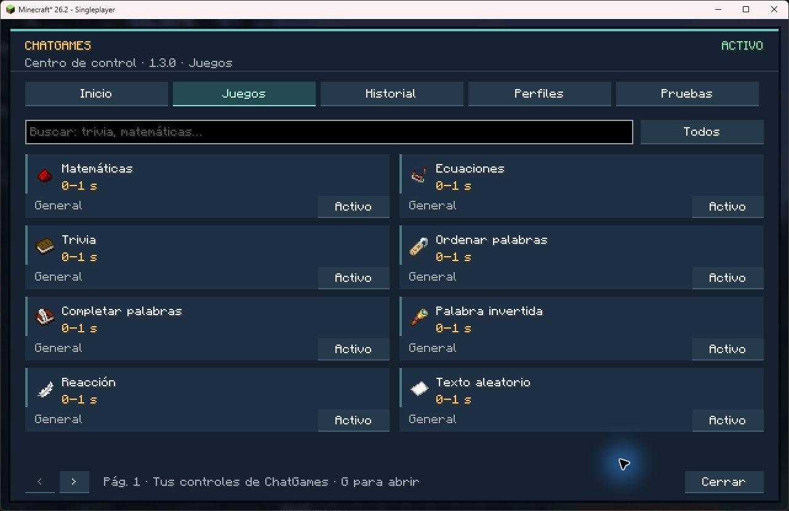
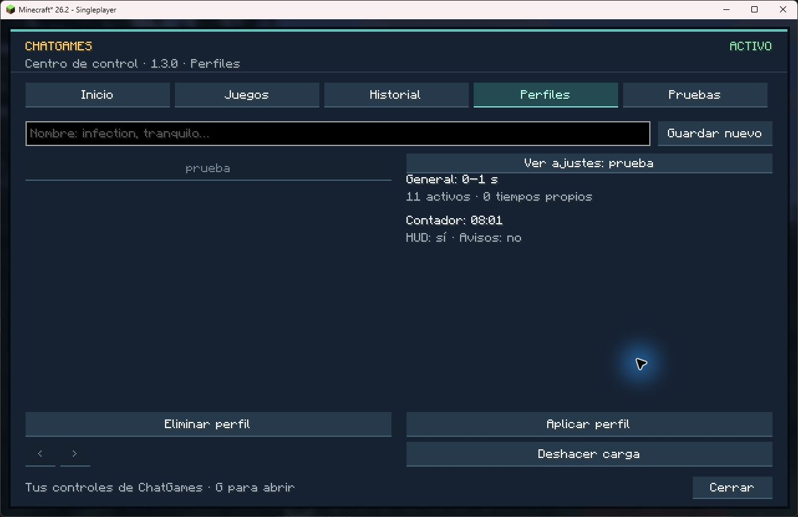
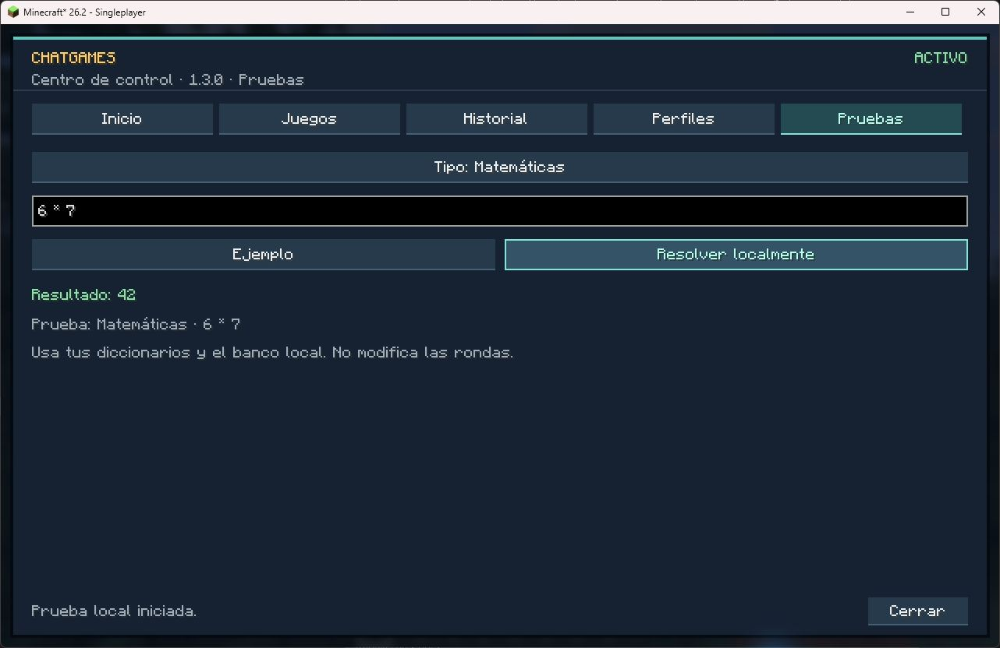

# ChatGames Universal Helper

**Un centro de control privado para los minijuegos del chat.** Versión **1.3.1** para **Minecraft Java 26.2**, con Fabric.

[Descargar JAR 1.3.1](https://github.com/Marco035xd/ChatGames-Universal-Helper/releases/download/v1.3.1/chatgames-universal-helper-1.3.1.jar) · [Releases](https://github.com/Marco035xd/ChatGames-Universal-Helper/releases) · [Cambios](CHANGELOG.md)

## Instalar o actualizar

1. Cierra Minecraft.
2. Coloca `chatgames-universal-helper-1.3.1.jar` en `mods` y retira el JAR anterior del helper. No instales el archivo `*-sources.jar`.
3. Conserva `config/chatgames-universal-helper/`: mantiene tus tiempos, estados, contador y respuestas aprendidas.
4. Inicia el juego y pulsa **G** para abrir el panel. **H** pausa o reanuda las respuestas.

| Requisito | Versión |
| --- | --- |
| Minecraft Java | 26.2 |
| Java | 25 o superior |
| Fabric Loader | 0.19.5 o superior |
| Fabric API | Compilado con 0.161.0+26.2 |

El mod se instala en el cliente. La interfaz, los avisos `[CGH]` y los comandos `/cgedit` son locales. Las respuestas automáticas sí se envían al chat del servidor. G y H se pueden reasignar en **Opciones → Controles → ChatGames**; actúan cuando estás jugando sin otra pantalla abierta.

## Nuevo sistema de Infection (1.3.1)

Reconoce los niveles **Fácil, Normal y Experto** y los muestra en el HUD, el historial y los comandos `last` e `history`. La dificultad se toma del anuncio del servidor; el tiempo de respuesta sigue siendo el configurado para cada tipo de juego.

Las operaciones se extraen completas, conservando sus paréntesis y la prioridad de multiplicaciones y divisiones. Por ejemplo: `765 ÷ 9 × 6 + (104 - 25) = 589`. Una expresión incompleta o inválida no se resuelve usando solo un fragmento.

También reconoce el nuevo resultado `Jugador respondió 589 en 23.3 s.`: cierra la ronda, cancela un envío pendiente, aprende la respuesta cuando corresponde y permite al contador mostrar el tiempo restante desde el inicio. El formato anterior sigue admitido.

Se añadieron **4 preguntas de trivia**, **5 anagramas exactos**, **4 patrones de palabras incompletas** y **1 palabra canónica** a partir de resultados confirmados. [Análisis del sistema nuevo](ANALISIS_CHATGAMES_2026_11_23_ES.md).


## Centro de control

Cinco pestañas comparten una interfaz oscura con acentos turquesa, navegación por teclado, descripciones al pasar el cursor y páginas adaptadas al tamaño de la ventana. La interfaz no pausa el mundo ni las respuestas.

### Inicio

Consulta los retos detectados, cuántos tuvieron algún envío, la media del primer envío y el contador del próximo minijuego. Incluye acceso a pausa general, tiempo general, contador, avisos y HUD.


### Juegos

Busca por nombre en español o por identificador (`math`, `trivia`, etc.), sin distinguir tildes o mayúsculas. Filtra todos, activos o pausados. Las tarjetas conservan sus iconos, explicaciones e intervalos propios; el botón de estado cancela el envío pendiente de ese juego al pausarlo.



| Juego | Identificador | Función |
| --- | --- | --- |
| Matemáticas | `math` | Operaciones aritméticas. |
| Ecuaciones | `variable` | Incógnitas con letras o símbolos. |
| Trivia | `trivia` | Banco local y respuestas aprendidas. |
| Ordenar palabras | `unscramble` | Anagramas con capitalización. |
| Completar palabras | `fillout` | Letras faltantes. |
| Palabra invertida | `unreverse` | Invierte el texto. |
| Reacción | `reaction` | Escribe el texto pedido. |
| Texto aleatorio | `random` | Conserva mayúsculas y minúsculas. |
| Clic en el chat | `clickable` | Utiliza el componente del reto. |
| Adivinar número | `guess_the_number` | Ajusta intentos según las pistas. |

El editor admite **tiempo fijo**, **intervalo aleatorio** y **heredar el tiempo general**. Acepta punto o coma decimal (`2.1`, `2,1`), milisegundos (`500ms`) y pasos de **−0.1 / +0.1 s**, con límites de 0 a 60 segundos. Incluye el acceso rápido **2.1–2.9 s**. Guardar aplica el ajuste; Cancelar o Escape descarta la edición.

El intervalo cuenta desde que el cliente recibe el **reto completo**, incluyendo cola y cálculo local. No hay una espera extra de 350 ms o 3 segundos para agrupar mensajes. Si el cálculo tarda más que el intervalo, el envío se realiza cuando la respuesta está lista. Los retos partidos esperan únicamente el texto que falta. Chat en vivo y registro se deduplican.

### Historial

Conserva hasta **100 retos detectados durante la ejecución actual** de Minecraft. Cada entrada muestra pregunta, respuesta calculada, fuente, estado, espera elegida, tiempo real del primer envío, cantidad de envíos y respuesta anunciada si se observó.

**Enviada** significa que el cliente envió la respuesta. **Ronda finalizada** indica que se observó su cierre. Ninguno de esos estados confirma que hayas ganado. La media se calcula solo sobre las rondas retenidas con al menos un envío; los reintentos no cuentan como nuevas rondas.

El tiempo real se mide con un reloj monótono desde la recepción completa hasta el envío del cliente. No incluye el viaje de red ni el procesamiento del servidor. Al pausar las respuestas no registra retos nuevos; el contador sigue sincronizándose. Al cerrar Minecraft se borra este historial; no guarda conversaciones, nombres de jugadores ni direcciones de servidores.

### Perfiles

Guarda hasta **32 configuraciones**, con nombres de 1 a 24 letras minúsculas, números, `_` o `-`.

- Guardan tiempos generales y propios, juegos activos, HUD, avisos y todos los ajustes del contador.
- **Ver ajustes** permite revisar los valores antes de aplicarlos.
- **Aplicar** cancela las respuestas pendientes y conserva la pausa general actual.
- **Deshacer carga** restaura la configuración anterior, incluso después de reiniciar. Puede alternar entre los dos últimos estados.
- Guardar nuevo no sobrescribe un nombre existente. Eliminar requiere confirmación dentro del panel o `confirm` en el comando.
- Los perfiles no incluyen IA, claves, rutas de logs, diagnóstico ni diccionarios personales.

Los archivos se guardan en `config/chatgames-universal-helper/profiles/`. La configuración y los perfiles se escriben mediante archivos temporales y sustitución, evitando truncar el archivo anterior si falla la escritura. Un fallo al aplicar restaura los valores en memoria.



### Pruebas

Prueba matemáticas, ecuaciones, trivia, anagramas, palabras incompletas, inversión y reacción. Elige el tipo, escribe el reto o carga un ejemplo y pulsa **Resolver localmente**. El resultado no se envía al servidor, no usa la IA externa ni crea una entrada en el historial.



## Contador del próximo minijuego

En **Inicio → Contador** puedes activar el panel superior, elegir vista permanente o solo los últimos diez segundos, modificar el intervalo en minutos y segundos y ajustar notas y volumen. La vista previa no cambia el horario real.

El valor inicial **08:01** procede de 191 rondas y 176 pares consecutivos de noviembre: intervalos de **08:00 a 08:03**, con media de 480.60 segundos. Se cuenta **entre inicios**, no desde el ganador. Si alguien responde a los 3 segundos, quedarían aproximadamente 07:58.

Cada inicio observado vuelve a sincronizarlo. Al entrar espera un reto real; mientras la ronda está activa muestra «Minijuego en curso» y después el tiempo restante. Al vencer la estimación espera el próximo anuncio, sin inventar rondas. El contador tiene su propio interruptor, independiente de la pausa de respuestas.

[Análisis de los intervalos de noviembre](ANALISIS_INTERVALOS_2026_11_ES.md). Es una estimación: los cambios del servidor, eventos manuales y la latencia pueden alterar el siguiente inicio.

## Comandos

`/cgedit help 1` hasta `/cgedit help 4` abre la ayuda paginada. **Haz clic en un comando de la ayuda para prepararlo en el chat**, sin ejecutarlo. Los argumentos y nombres de perfiles tienen autocompletado.

| Comando | Acción |
| --- | --- |
| `/cgedit gui` o `/cgedit menu` | Abre el centro de control. |
| `/cgedit on` / `off` | Activa o pausa las respuestas. |
| `/cgedit pause` / `resume` | Alternativas descriptivas para pausar y reanudar. |
| `/cgedit game trivia on` | Activa un tipo; acepta `off` y los demás identificadores. |
| `/cgedit hud on` / `off` | Muestra u oculta el panel del reto. |
| `/cgedit stats on` / `off` | Controla el aviso local de respuesta enviada. |
| `/cgedit report` | Resumen de los últimos 100 retos de la ejecución. |
| `/cgedit history 1` | Historial, cinco rondas por página. |
| `/cgedit last` / `status` | Último reto o estado del mod. |
| `/cgedit profile list` | Lista los perfiles guardados. |
| `/cgedit profile save infection` | Guarda un perfil nuevo. |
| `/cgedit profile show infection` | Consulta sus ajustes. |
| `/cgedit profile load infection` | Lo aplica y cancela los envíos pendientes. |
| `/cgedit profile undo` | Restaura los ajustes anteriores a la carga. |
| `/cgedit profile delete infection confirm` | Elimina únicamente ese perfil. |
| `/cgedit settime` | Consulta tiempos. |
| `/cgedit settime 0s` | Tiempo general sin espera añadida. |
| `/cgedit settime random 0s 1s` | Intervalo general. |
| `/cgedit settime trivia 2.1` | Tiempo fijo propio; también acepta `2,1`. |
| `/cgedit settime trivia random 2.1 2.9` | Intervalo propio. |
| `/cgedit settime math default` | Vuelve a heredar el tiempo general. |
| `/cgedit countdown on` / `off` | Activa o apaga el contador. |
| `/cgedit countdown interval 8 1` | Intervalo de 8 minutos y 1 segundo. |
| `/cgedit countdown view full` / `last10` | Cuenta permanente o aviso final. |
| `/cgedit countdown sound on` / `off` | Activa o silencia las notas. |
| `/cgedit countdown sync 60` | Sincroniza manualmente: faltan 60 segundos. |
| `/cgedit test math 6 * 7` | Prueba una solución sin enviarla. |
| `/cgedit simulate <texto>` | Prueba la detección sin responder. |
| `/cgedit debug on` / `off` | Detalles locales de detección y envío. |
| `/cgedit testlog` | Diagnóstico de lectura del registro. |
| `/cgedit cache stats` | Entradas guardadas. |
| `/cgedit ai status` | Estado de la IA opcional. |

Para el tipo RANDOM: `settime random 2s` fija su tiempo, `settime random random 0s 1s` configura su rango y `settime random 0s 1s` configura el rango general.

## Datos y compatibilidad

La actualización conserva las preferencias de 1.2.5 y 1.3.0. Siguen disponibles la tecla G, los intervalos decimales, la detección inmediata y las migraciones anteriores. Los modos pausados conservan su estado. Los tiempos ya programados se conservan al editar un intervalo; una pausa o una carga de perfil cancela los pendientes.

La base incluye las respuestas confirmadas de las 328 rondas de octubre: [análisis de octubre](ANALISIS_LOGS_2026_10_ES.md) y [análisis histórico](ANALISIS_LOGS_ES.md). Los diccionarios personales y las respuestas aprendidas mantienen su prioridad. Una solución desconocida o ambigua puede quedar sin enviar; la IA externa es opcional.

No se muestran HOVERABLE ni los objetivos HUNT, MINE, PLACE, FISH, EAT, CRAFT o FURNACE en las tarjetas. Sus implementaciones anteriores no se amplían en esta versión.

## Desarrollo y verificación

Con Java 25:

```powershell
.\gradlew.bat build
.\gradlew.bat runClient
```

En Linux/macOS: `./gradlew build`. Gradle Wrapper 9.7.1 genera el JAR instalable y el de fuentes en `build/libs/`. GitHub Actions compila y ejecuta las pruebas en cada push.

**100 pruebas JUnit aprobadas**, con detección y tiempos anteriores, perfiles y restauración ante fallos, cancelación de envíos, historial deduplicado y comandos. Las siete pruebas nuevas reproducen las 26 rondas recientes, los resultados sin comillas, la dificultad, expresiones incompletas, aprendizaje, sincronización del contador y conservación de preferencias.

Verificación visual y funcional en Minecraft 26.2, con un mundo local separado: G/H, pestañas, búsqueda, laboratorio, guardar/cargar/deshacer perfiles, respuesta real `6 * 7 → 42`, cierre de ronda, contador e historial. En la comprobación de 1.3.1 se reprodujo el reto Experto de la captura: respuesta 589, espera elegida de 631 ms, un envío a los 636 ms y cierre con el nuevo formato. El historial mostró dificultad Experto y respuesta anunciada 589. No se probó en el servidor remoto Infection. Las capturas corresponden al cliente de desarrollo.

No se distribuyen mundos de pruebas, configuraciones personales ni registros completos. El historial es temporal; los perfiles y la configuración se guardan localmente.

## Licencia

Código bajo [MIT](LICENSE). Los diccionarios ampliados de terceros conservan su atribución **CC BY-SA 4.0** en [WORDLIST_NOTICE.md](WORDLIST_NOTICE.md).
