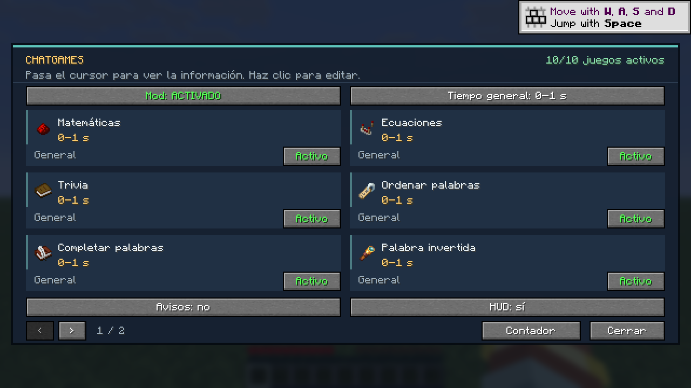
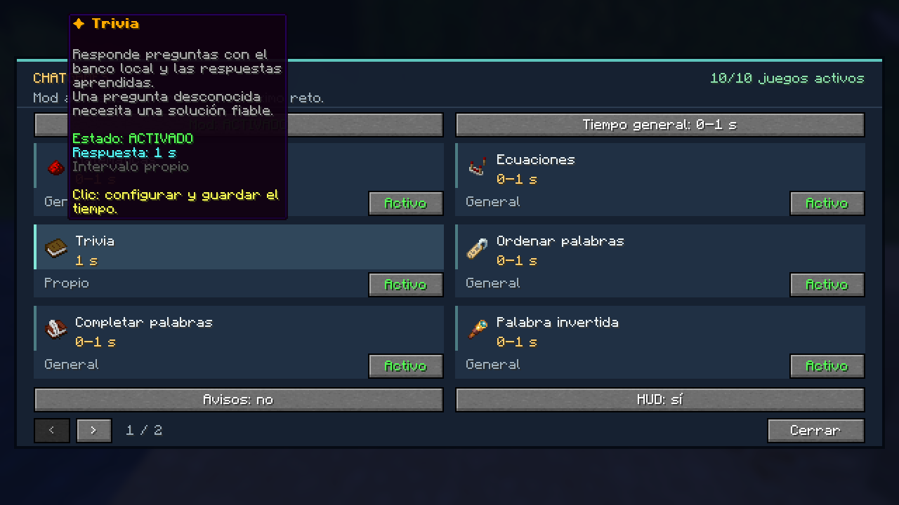
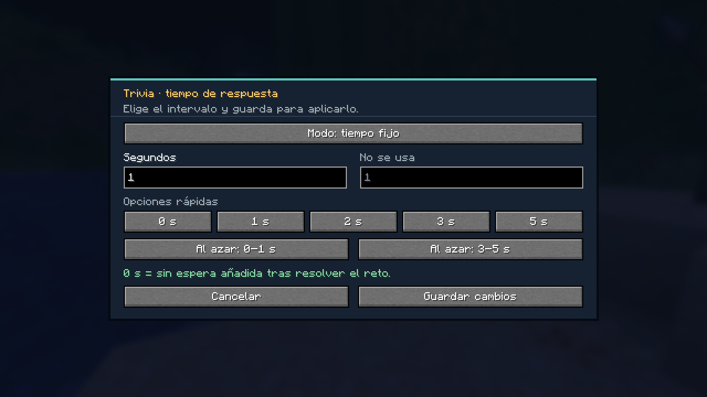
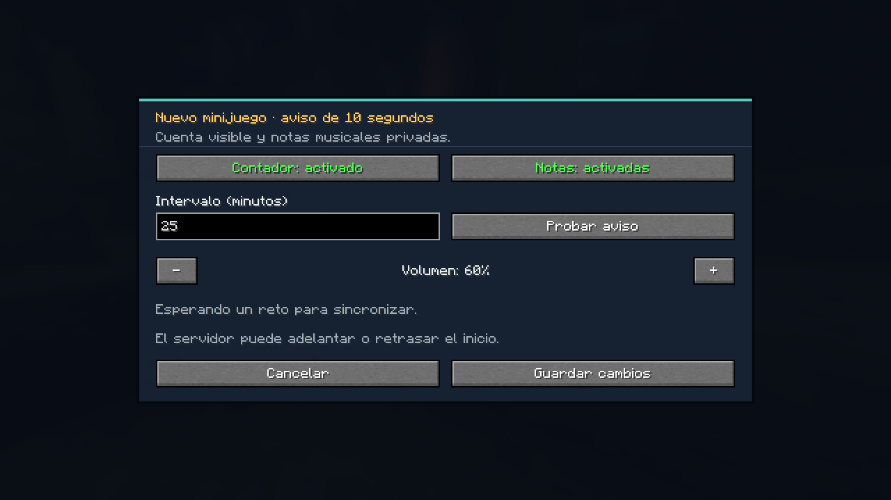
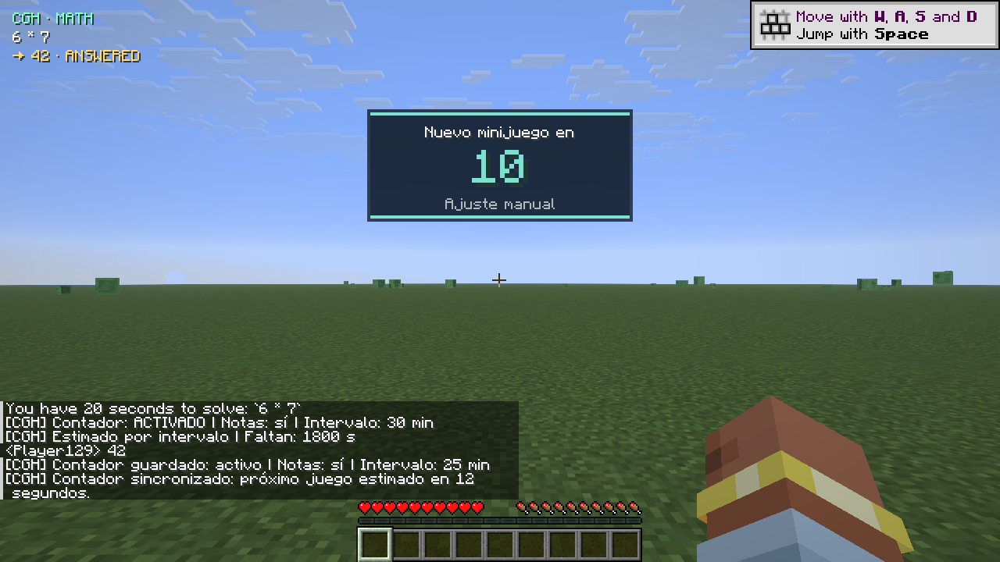

# ChatGames Universal Helper

Mod de cliente Fabric para resolver desafíos del chat y configurar sus respuestas mediante una interfaz privada. Versión **1.2.5**, desarrollada para **Minecraft Java 26.2**.

## Descargar

[Descargar JAR 1.2.5](https://github.com/Marco035xd/ChatGames-Universal-Helper/releases/download/v1.2.5/chatgames-universal-helper-1.2.5.jar) · [Ver releases](https://github.com/Marco035xd/ChatGames-Universal-Helper/releases)

Instala el JAR del mod en `mods`; el archivo `*-sources.jar` contiene el código fuente para desarrolladores.

## Requisitos

| Componente | Versión |
| --- | --- |
| Minecraft Java | 26.2 |
| Java | 25 o superior |
| Fabric Loader | 0.19.5 o superior |
| Fabric API | 0.161.0+26.2 utilizada para compilar |

El JAR se instala en el cliente del jugador. La GUI se dibuja localmente y sus comandos se registran como comandos de cliente. No hace falta instalar un plugin de interfaz en el servidor.

## Instalación

1. Cierra Minecraft e instala Fabric y Fabric API para 26.2.
2. Coloca `chatgames-universal-helper-1.2.5.jar` en `mods`.
3. Retira el JAR anterior del helper y deja una sola versión.
4. Conserva `config/chatgames-universal-helper/` para mantener tus preferencias y respuestas aprendidas.
5. Inicia Minecraft y pulsa **G** dentro del juego para abrir la interfaz, o utiliza `/cgedit gui`.

Esta actualización conserva los tiempos y preferencias configurados en 1.0.9, 1.1.0, 1.2.0, 1.2.1, 1.2.2, 1.2.3 y 1.2.4. Una configuración más antigua recibe la migración previa a 0–1 segundo una sola vez. No se reactivan juegos que hayas pausado.

### Base de respuestas actualizada

La versión 1.2.1 incorpora 15 preguntas de trivia, 57 patrones para completar palabras, 52 anagramas concretos y 19 palabras del servidor, a partir de 328 rondas confirmadas en 70 registros del **2 al 20 de octubre de 2026**. Los cinco tipos de juego observados ya estaban contemplados por el mod. Solo se utilizaron respuestas anunciadas por el servidor, conservando su escritura exacta.

Los datos nuevos también están disponibles con una configuración existente; las respuestas aprendidas y los diccionarios personales conservan su prioridad. El detalle y las referencias están en [ANALISIS_LOGS_2026_10_ES.md](ANALISIS_LOGS_2026_10_ES.md).

## Interfaz privada

Pulsa **G** dentro del juego, o utiliza `/cgedit gui` o `/cgedit menu`.

Puedes cambiar la tecla en **Opciones → Controles → Asignación de teclas → ChatGames → Abrir menú de ChatGames**. El atajo funciona con las respuestas automáticas en pausa y se activa cuando estás jugando sin otra pantalla abierta. La asignación se guarda mediante los controles de Minecraft.

- **Tarjetas de minijuegos:** muestran un objeto, el nombre y el tiempo efectivo. Pasa el cursor sobre el objeto o tarjeta para ver el lore, ejemplos, estado y si hereda el tiempo general.
- **Activo / Pausado:** cambia el estado de ese minijuego, lo guarda inmediatamente y cancela su envío pendiente al pausarlo.
- **Clic en la tarjeta:** abre su editor de intervalo.
- **Mod ACTIVADO / EN PAUSA:** controla todas las respuestas; conserva los estados individuales.
- **Tiempo general:** edita el intervalo común de los modos que lo heredan.
- **Avisos:** muestra u oculta el mensaje local «Respuesta enviada». Este control no apaga las respuestas.
- **HUD:** muestra u oculta el panel de estado durante un desafío.
- **Contador:** configura la cuenta superior en minutos:segundos, su visibilidad, el intervalo y el sonido final.
- **Flechas:** cambian de página; el número de tarjetas se adapta a la escala de GUI.

En el editor puedes elegir **tiempo fijo**, **intervalo aleatorio** o **usar tiempo general**. Cada minijuego admite su propio tiempo decimal entre 0 y 60 segundos, escrito con punto o coma (`2.1` o `2,1`); también acepta unidades como `500ms`.

- **Tiempo fijo:** escribe, por ejemplo, `2.1` para añadir siempre 2.1 segundos de espera.
- **Intervalo aleatorio:** escribe `2.1` como mínimo y `2.9` como máximo para elegir una espera entre ambos límites en cada respuesta.
- **Botones −0.1 / +0.1:** ajustan cada campo por décimas, como 2.1, 2.2, 2.3… 2.9, 3.0, 3.1. También funcionan en cualquier otro segundo hasta 60.
- **Opciones rápidas:** tiempos fijos de 0, 1, 2, 3 y 5 segundos, y rangos de 0–1, **2.1–2.9** y 3–5 segundos.

Para configurar el ejemplo: pulsa **G**, elige la tarjeta del minijuego, pulsa **2.1–2.9 s** o edita los campos y guarda los cambios. Los valores se conservan con precisión de milisegundos; el intervalo aleatorio puede elegir valores intermedios entre las décimas.

**Guardar cambios** valida y escribe el ajuste; se conserva al reiniciar. **Cancelar** o **Escape** vuelve sin guardar el intervalo que estabas editando. El mínimo no puede superar al máximo. Si el guardado del intervalo falla, el valor anterior se conserva en memoria.

Los nuevos tiempos se aplican a las próximas respuestas. Una respuesta ya programada conserva su intervalo. Desde la versión 1.2.4, el tiempo se cuenta desde que el cliente **recibe el reto completo**, incluyendo el procesamiento y el cálculo local. Por ejemplo, 2.1–2.9 s elige el momento de envío dentro de ese intervalo desde la recepción. Si el cálculo ya consumió ese tiempo, el mod envía en cuanto obtiene la respuesta. Con **0 s** no añade una espera.

El mod procesa el chat en vivo y utiliza el registro como respaldo sin duplicar las respuestas. **Ya no espera 350 ms de silencio ni hasta 3 segundos para agrupar mensajes.** Solo conserva las líneas de un reto cuando falta texto necesario para resolverlo; los mensajes de jugadores no lo retrasan ni se mezclan con él.

La latencia de conexión, la carga del cliente y el procesamiento del servidor pueden afectar al tiempo que muestra el servidor. La IA opcional también puede tardar más que el intervalo elegido. La GUI no pausa el servidor ni un mundo local, y el mod puede seguir respondiendo mientras está abierta.

### Capturas de la interfaz







## Contador del próximo minijuego

El panel superior muestra **«Nuevo minijuego en 07:58»**, con minutos y segundos durante toda la espera. Mientras el reto está activo, indica **«Minijuego en curso»**. Al responder alguien o terminar la ronda, muestra el tiempo restante hasta el siguiente inicio estimado.

El intervalo se cuenta **entre inicios de minijuegos**, no desde el ganador. Por ejemplo, con un intervalo de 08:01 y una respuesta a los 3 segundos, al terminar quedan 07:58. Cada inicio real vuelve a sincronizar la cuenta.

Se revisaron **191 rondas de noviembre** y **176 pares consecutivos**: el intervalo observado fue de **08:00 a 08:03**, con una media de 480.60 segundos. El valor inicial es **08:01**. El informe [ANALISIS_INTERVALOS_2026_11_ES.md](ANALISIS_INTERVALOS_2026_11_ES.md) incluye ejemplos de horas, diferencias y referencias a las líneas originales.

Pulsa **G → Contador** para cambiar:

- **Contador: activado/apagado:** controla el panel y los avisos, independientemente de las respuestas automáticas.
- **Vista: permanente / solo últimos 10 segundos:** elige entre la cuenta completa arriba o únicamente el aviso final.
- **Minutos y segundos:** intervalo entre inicios; por ejemplo, minutos `8` y segundos `1`.
- **Notas:** activa o silencia una nota privada por número durante los últimos 10 segundos.
- **Volumen:** de 0 a 100%.

**Guardar cambios** conserva los ajustes al reiniciar. **Cancelar** los descarta. **Probar 10 s** muestra una vista previa independiente: no guarda cambios ni modifica el horario del contador real. El sonido usa notas de Minecraft y no necesita paquetes de recursos.

La versión 1.2.5 cambia el antiguo intervalo predeterminado de 25 minutos a 08:01. Conserva los intervalos distintos de ese antiguo valor, el estado activado/apagado, las notas, el volumen y los tiempos de respuesta de cada juego.

Al entrar o cambiar de conexión, el mod espera observar un reto real antes de calcular la siguiente ronda. Se reconocen instrucciones, cabeceras de ChatGames/Minijuego y anuncios explícitos en español e inglés. El panel muestra que está esperando sincronización y no presenta una hora inventada.

El contador es una **estimación del cliente**: un evento manual, cambios de horario, carga del servidor o latencia pueden alterar el siguiente inicio. Al vencer la cuenta, espera el próximo anuncio real. No inventa rondas sucesivas. La referencia se borra al desconectarse.

```text
/cgedit countdown
/cgedit countdown on
/cgedit countdown off
/cgedit countdown view full
/cgedit countdown view last10
/cgedit countdown interval 8 1
/cgedit countdown sound on
/cgedit countdown sound off
/cgedit countdown sync 60
```

`interval 8 1` establece 8 minutos y 1 segundo; la forma anterior `interval 25` sigue significando 25 minutos exactos. `sync 60` indica que conoces que faltan 60 segundos; no cambia el intervalo entre rondas. `/cgedit off` pausa las **respuestas automáticas**; el contador tiene su propio interruptor.

Las capturas siguientes corresponden a la interfaz anterior del aviso final:





## Minijuegos de la GUI

| Juego | Función |
| --- | --- |
| Matemáticas | Sumas, restas, multiplicaciones y otras operaciones. |
| Ecuaciones | Resuelve incógnitas de letras y símbolos en varias líneas. |
| Trivia | Banco local y respuestas aprendidas; no copia la pregunta como respuesta. |
| Ordenar palabras | Anagramas de una palabra o frase; conserva la capitalización. |
| Completar palabras | Letras faltantes y escritura esperada por el servidor. |
| Palabra invertida | Invierte el texto solicitado. |
| Reacción | Escribe el texto del reto. |
| Texto aleatorio | Conserva exactamente mayúsculas y minúsculas. |
| Clic en el chat | Utiliza el componente pulsable del evento. |
| Adivinar número | Ajusta los intentos según las pistas; usa el intervalo del modo. |

La interfaz no incorpora HOVERABLE ni HUNT, MINE, PLACE, FISH, EAT, CRAFT o FURNACE. Su implementación anterior permanece fuera del alcance de esta revisión.

Las respuestas desconocidas o ambiguas pueden quedar sin enviar si no hay una solución local fiable. Una IA externa es opcional y solo se consulta cuando está configurada. El banco incluido procede de los desafíos y resultados proporcionados durante el desarrollo; los anuncios posteriores del servidor permiten aprender respuestas.

## Comandos

| Comando | Descripción |
| --- | --- |
| `/cgedit gui` o `/cgedit menu` | Abre tu interfaz privada. |
| `/cgedit on` / `/cgedit off` | Activa o pausa las respuestas; `off` cancela las pendientes. |
| `/cgedit game <tipo> on/off` | Controla un juego específico. |
| `/cgedit settime` | Muestra los intervalos configurados. |
| `/cgedit settime 0s` | Tiempo general sin espera añadida. |
| `/cgedit settime random 0s 1s` | Intervalo general de 0–1 segundo. |
| `/cgedit settime trivia 1s` | Tiempo propio de trivia. |
| `/cgedit settime trivia 2.1` | Tiempo fijo de 2.1 segundos para trivia. También acepta `2,1`. |
| `/cgedit settime trivia random 2.1 2.9` | Intervalo propio de 2.1 a 2.9 segundos. También acepta `2,1 2,9`. |
| `/cgedit settime variable random 3s 5s` | Rango propio para ecuaciones. |
| `/cgedit settime math default` | Hace que matemáticas vuelva a heredar el tiempo general. |
| `/cgedit stats on/off` | Avisos locales de respuesta enviada. |
| `/cgedit debug on/off` | Detalles de detección y envío. |
| `/cgedit status` / `/cgedit last` | Estado del mod y último reto. |
| `/cgedit cache stats` | Cantidad de entradas guardadas. |
| `/cgedit ai status` | Estado de la IA opcional. |
| `/cgedit test <tipo> <texto>` | Prueba una solución sin enviarla. |
| `/cgedit simulate <texto>` | Prueba la detección sin enviar una respuesta. |
| `/cgedit testlog` | Diagnóstico del registro leído. |
| `/cgedit help 1`, `2` o `3` | Ayuda con descripciones y autocompletado. |

El modo llamado RANDOM tiene una sintaxis propia: `/cgedit settime random 0s` fija su tiempo y `/cgedit settime random random 0s 1s` configura su rango. `/cgedit settime random 0s 1s` sigue configurando el rango **general**. Los modos con un intervalo propio lo conservan al cambiar el general.

## Archivos de configuración

Se guardan en `config/chatgames-universal-helper/`:

- `config.json`: activación, modos, tiempo general, intervalos propios, HUD y avisos.
- `trivia.json` y `trivia-cache.json`: respuestas personales y aprendidas.
- `word-cache.json`: respuestas aprendidas para palabras.
- `words-es.txt` y `words-en.txt`: vocabulario personal.

La GUI escribe los mismos ajustes que los comandos. Puedes ampliar tus preguntas y palabras; reinicia después de editar los archivos a mano. No subas configuraciones privadas, registros completos ni credenciales al repositorio.

## Compilar y probar

El proyecto incluye el Gradle Wrapper **9.7.1**. Con Java 25 instalado:

```bash
# Linux / macOS
chmod +x gradlew
./gradlew build
```

```powershell
# Windows
.\gradlew.bat build
```

El JAR instalable se genera en `build/libs/chatgames-universal-helper-1.2.5.jar`. El archivo `*-sources.jar` contiene fuentes y no se instala en `mods`. `build` compila, ejecuta las pruebas JUnit y remapea el mod para Minecraft. `./gradlew runClient` inicia el cliente de desarrollo; necesita entorno gráfico y descarga los recursos del juego.

## Publicar en GitHub

1. Descomprime el ZIP de código fuente.
2. Sube el **contenido de la carpeta del proyecto**: `src/`, `gradle/`, `gradlew`, `gradlew.bat`, archivos Gradle, `README.md`, `LICENSE`, `WORDLIST_NOTICE.md`, `docs/`, `.gitignore` y `.github/`.
3. No subas `build/`, `.gradle/`, `run/`, tus logs ni configuraciones personales. `.gitignore` ya los excluye.
4. El workflow de `.github/workflows/build.yml` usa Java 25, compila y ejecuta pruebas cuando se hace push o se abre un pull request.
5. Crea una Release con etiqueta `v1.2.5` y adjunta el JAR instalable como archivo de descarga.

El proyecto no contiene tokens ni claves de API. La IA opcional toma la clave de una variable de entorno configurada por el usuario.

## Estructura

- `gui/`: tarjetas, paginación, editores y vista previa del contador.
- `countdown/`: reloj, sincronización, notas y ajustes del aviso.
- `command/`: comandos de cliente, ayuda y autocompletado.
- `game/`: detección, sesiones, programación y cancelación de respuestas.
- `solver/`: matemáticas, ecuaciones, trivia y palabras.
- `config/`: preferencias, persistencia y migraciones.
- `chat/`, `log/`, `hud/`, `ai/`: envío, lectura, estado e IA opcional.
- `src/test/`: pruebas de solucionadores, registros, cancelación y configuración de la GUI.

## Licencia y atribuciones

El código del mod se distribuye bajo MIT; consulta [LICENSE](LICENSE). Los diccionarios ampliados son contenido de terceros bajo **CC BY-SA 4.0** y tienen su atribución en [WORDLIST_NOTICE.md](WORDLIST_NOTICE.md). [ANALISIS_LOGS_ES.md](ANALISIS_LOGS_ES.md) conserva el análisis histórico de los retos incorporados en 1.0.7.


## Verificación de 1.2.5

Compilación con `./gradlew --offline build` y **82 pruebas JUnit aprobadas**, sin fallos, errores ni pruebas omitidas. Las pruebas nuevas comprueban el texto visible en minutos:segundos, el tiempo descontado tras el resultado, la sincronización de fuentes duplicadas, las 176 mediciones de noviembre, los controles y los ajustes guardados. La apariencia del panel no se probó manualmente en Minecraft ni se verificó el horario futuro del servidor remoto.

## Verificación de 1.2.4

Compilación con `./gradlew --offline build` y **75 pruebas JUnit aprobadas**. Las pruebas nuevas comprueban la detección inmediata desde el chat y desde el registro sin forzar el vaciado de mensajes, el plazo de 2.3 segundos del anagrama `aotP → Pato`, el tiempo de cola incluido en el intervalo, las preguntas partidas en español e inglés, las ecuaciones y la deduplicación de las 328 rondas de octubre. El cambio no se probó en el servidor remoto de Minecraft.

## Verificación de 1.2.3

Compilación completada con `./gradlew --offline build`: **69 pruebas JUnit aprobadas**, sin fallos, errores ni pruebas omitidas. Las pruebas nuevas comprueban los pasos exactos de 0.1 segundos entre 0 y 60, el guardado de tiempos fijos e intervalos decimales por minijuego y los comandos con punto o coma. Se verificó que el JAR tiene la versión 1.2.3 y conserva las bases de respuestas y las traducciones del acceso con G. La distribución visual del editor no se probó manualmente dentro de Minecraft.

## Verificación de 1.2.2

Compilación completada con `./gradlew --offline build`: **65 pruebas JUnit aprobadas**, sin fallos, errores ni pruebas omitidas. Se verificaron la versión 1.2.2 del JAR y las traducciones del nuevo control incluidas en el archivo. La pulsación de G no se probó manualmente dentro de Minecraft.

## Verificación de 1.2.1

Compilación completada con `./gradlew build`: **65 pruebas JUnit aprobadas**, sin fallos, errores ni pruebas omitidas. Las pruebas nuevas comprueban la detección y las respuestas exactas de las 328 rondas de octubre, su disponibilidad en una instalación con configuración existente, la conservación de los datos personales y las tildes del vocabulario nuevo. Se verificó además que el JAR generado contiene la versión 1.2.1 y los cuatro recursos de respuestas actualizados.

## Verificación de 1.2.0

62 pruebas JUnit aprobadas, sin fallos, errores ni pruebas omitidas. Se verificaron la secuencia 10–1, las notas únicas, la deduplicación de chat y log, los avisos en español, la desconexión, los ajustes guardados y la cancelación. Las pruebas anteriores de los solucionadores y los registros confirmados también pasaron.

Además, el cliente se ejecutó con Minecraft 26.2, Fabric Loader 0.19.5 y Java 25. En un mundo local se comprobaron la apertura de la GUI con objetos, la cuenta atrás sobre el HUD, los controles del contador y respuestas reales: `6 * 7 → 42` y `3*x + 4 = 19 → 5`, una vez cada una. El motor de sonido ejecutó las notas en un dispositivo virtual de prueba. No se verificó el horario automático del servidor remoto; el intervalo debe coincidir con su configuración.
