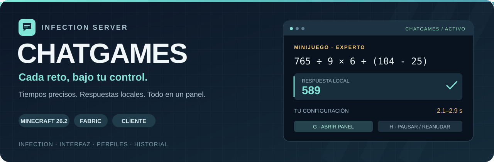
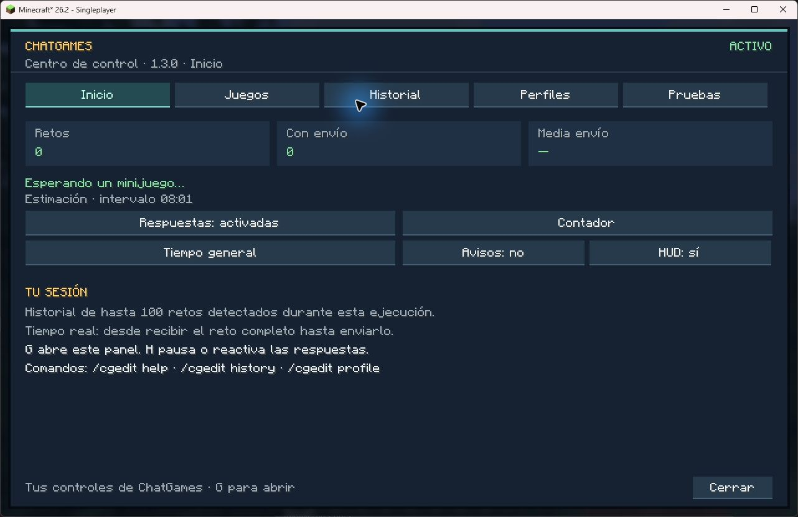
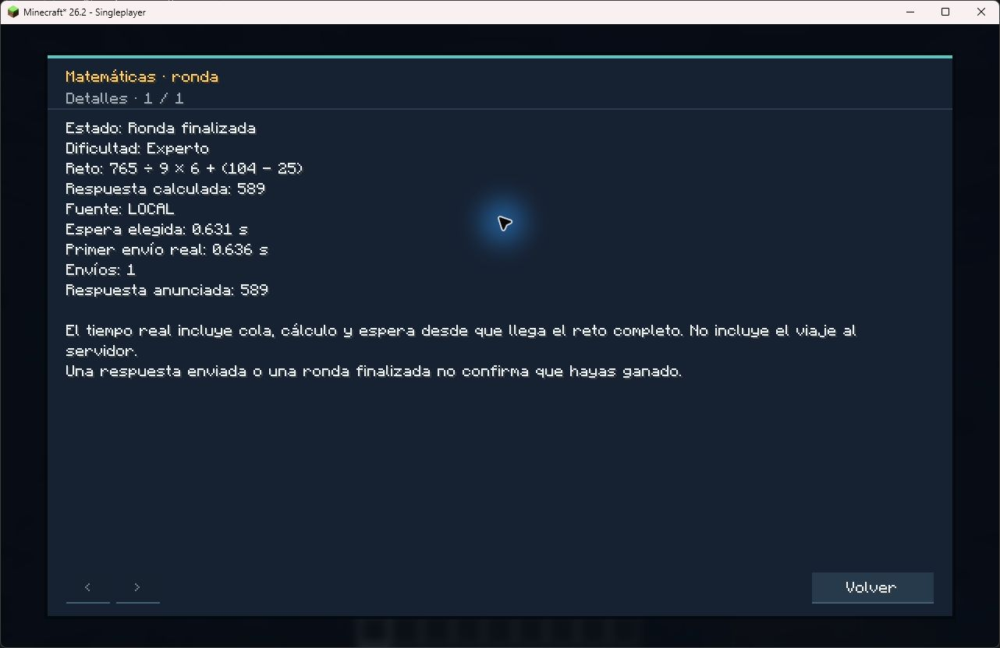

<a id="inicio"></a>

<p align="center">
  
</p>

<h1 align="center">Tu centro de control para ChatGames</h1>

<p align="center">
  Resuelve los retos del chat, ajusta tus tiempos y prepara tus perfiles.<br />
  <strong>Un mod de cliente para Minecraft Java 26.2 con Fabric.</strong>
</p>

<p align="center">
  <a href="https://github.com/Marco035xd/ChatGames-Universal-Helper/releases/tag/v1.3.1"></a>
  
  
  
  <a href="#verificacion"></a>
  <a href="LICENSE"></a>
</p>

<p align="center">
  <a href="https://github.com/Marco035xd/ChatGames-Universal-Helper/releases/download/v1.3.1/chatgames-universal-helper-1.3.1.jar"><strong>↓ Descargar JAR 1.3.1</strong></a>
  &nbsp; · &nbsp;
  <a href="https://github.com/Marco035xd/ChatGames-Universal-Helper/releases">Todas las versiones</a>
  &nbsp; · &nbsp;
  <a href="CHANGELOG.md">Novedades</a>
</p>

<p align="center">
  <a href="#instalacion">Instalación</a> &nbsp; / &nbsp;
  <a href="#interfaz">Interfaz</a> &nbsp; / &nbsp;
  <a href="#minijuegos">Minijuegos</a> &nbsp; / &nbsp;
  <a href="#comandos">Comandos</a> &nbsp; / &nbsp;
  <a href="#desarrollo">Desarrollo</a>
</p>

---

## ✨ Un panel para toda la partida

| 🎛️ Configura a tu ritmo | 📚 Aprende de cada ronda |
| --- | --- |
| **Tiempos por minijuego.** Valores fijos o intervalos aleatorios, con pasos de 0.1 segundos. | **Respuestas locales.** Trivia y palabras con datos confirmados y aprendizaje del resultado. |
| **Perfiles guardados.** Prepara tus ajustes, revisa sus valores y deshaz la última carga. | **Historial de 100 retos.** Pregunta, respuesta, dificultad y tiempo real del primer envío. |
| **Cuenta atrás.** Minutos y segundos hasta el próximo minijuego estimado. | **Laboratorio privado.** Prueba un reto sin enviar mensajes al servidor. |

<p align="center">
  <a href="docs/images/games-130.jpg"></a><br />
  <sub>Busca un minijuego, configura su intervalo y activa o pausa sus respuestas.</sub>
</p>

<a id="instalacion"></a>

## 🚀 Empieza en cuatro pasos

1. **Cierra Minecraft** e instala Fabric y Fabric API para **26.2**.
2. Descarga [**chatgames-universal-helper-1.3.1.jar**](https://github.com/Marco035xd/ChatGames-Universal-Helper/releases/download/v1.3.1/chatgames-universal-helper-1.3.1.jar) y colócalo en `mods`.
3. Si estás actualizando, retira el JAR anterior y conserva `config/chatgames-universal-helper/`.
4. Entra al juego y pulsa **G** para abrir el centro de control.

> **Atajos:** `G` abre el panel · `H` pausa o reanuda las respuestas · `/cgedit gui` abre la misma interfaz.
>
> Puedes reasignarlos en **Opciones → Controles → ChatGames**. Los atajos actúan mientras juegas sin otra pantalla abierta. Instala el JAR principal; `-sources.jar` contiene las fuentes para desarrolladores.

<details>
<summary><strong>Ver requisitos y funcionamiento del cliente</strong></summary>

| Componente | Versión |
| --- | --- |
| Minecraft Java | **26.2** |
| Java | **25 o superior** |
| Fabric Loader | **0.19.5 o superior** |
| Fabric API | Compilado con **0.161.0+26.2** |

El mod se instala en el cliente. La interfaz, los comandos `/cgedit` y los avisos `[CGH]` son locales; las respuestas automáticas se envían al chat del servidor. La interfaz permite que las respuestas sigan funcionando mientras está abierta y no pausa el mundo.

La descarga pertenece a un repositorio privado: necesitas iniciar sesión en GitHub con una cuenta que tenga acceso.

</details>

<a id="interfaz"></a>

## 🖥️ Diseñado para usarlo dentro del juego

**Inicio → Juegos → Historial → Perfiles → Pruebas.** Cinco pestañas con navegación por teclado, descripciones al pasar el cursor y páginas que se adaptan al tamaño de tu ventana.

<table>
  <tr>
    <td width="50%" valign="top">
      <h3>Inicio · todo a la vista</h3>
      <a href="docs/images/dashboard-130.jpg"></a>
      <p>Estado del mod, cuenta atrás, estadísticas y acceso a los ajustes principales.</p>
    </td>
    <td width="50%" valign="top">
      <h3>Perfiles · tus ajustes preparados</h3>
      <a href="docs/images/profiles-130.jpg"></a>
      <p>Guarda hasta 32 perfiles, revisa su contenido y restaura la configuración anterior.</p>
    </td>
  </tr>
  <tr>
    <td width="50%" valign="top">
      <h3>Pruebas · resuelve antes de jugar</h3>
      <a href="docs/images/practice-130.jpg"></a>
      <p>Escribe un reto o carga un ejemplo. Obtén una solución local sin enviarla al chat.</p>
    </td>
    <td width="50%" valign="top">
      <h3>Historial · entiende cada envío</h3>
      <a href="docs/images/expert-131.jpg"></a>
      <p>Consulta la dificultad, la respuesta calculada, el tiempo real y el resultado anunciado.</p>
    </td>
  </tr>
</table>

<sub>Capturas del cliente de desarrollo: paneles de 1.3.0 y detalle de Experto de 1.3.1. Haz clic para ampliarlas. La portada es una ilustración del proyecto.</sub>

<details>
<summary><strong>Historial, perfiles y pruebas: qué guardan y cómo funcionan</strong></summary>

**Historial.** Hasta 100 retos detectados durante la ejecución actual. Muestra pregunta, respuesta, fuente, estado, dificultad, espera elegida, primer envío real, cantidad de envíos y respuesta anunciada. La media incluye solo las rondas retenidas con algún envío. Los reintentos no cuentan como rondas nuevas.

«Enviada» indica que el cliente envió la respuesta; «Ronda finalizada» indica que se observó el cierre. Estos estados no confirman una victoria. El tiempo real incluye cola, cálculo y espera desde recibir el reto completo; no incluye el viaje de red ni el procesamiento del servidor. Al pausar las respuestas no registra retos nuevos. Al cerrar Minecraft se borra el historial.

**Perfiles.** Guardan tiempos generales y propios, juegos activos, HUD, avisos y ajustes del contador. Usa nombres de 1 a 24 letras minúsculas, números, `_` o `-`, hasta un máximo de 32 perfiles. Puedes ver sus ajustes antes de aplicarlos. La carga cancela respuestas pendientes y conserva la pausa general. «Deshacer carga» restaura el estado anterior, incluso tras reiniciar, y permite alternar entre los dos últimos estados.

Guardar nuevo conserva los perfiles existentes. Eliminar pide confirmación. Los perfiles se guardan en `config/chatgames-universal-helper/profiles/` y excluyen IA, claves, rutas de logs, diagnóstico y diccionarios. La escritura de configuración y perfiles utiliza archivos temporales y sustitución; un fallo de carga restaura los valores anteriores en memoria.

**Pruebas.** Matemáticas, ecuaciones, trivia, anagramas, palabras incompletas, inversión y reacción. El laboratorio usa el solucionador local, no consulta IA externa y no crea entradas en el historial.

</details>

<a id="minijuegos"></a>

## 🧩 Diez minijuegos, tiempos independientes

| Minijuego | Identificador | Qué resuelve |
| --- | --- | --- |
| 🔢 Matemáticas | `math` | Operaciones y expresiones con paréntesis. |
| 🧮 Ecuaciones | `variable` | Incógnitas con letras o símbolos. |
| 📖 Trivia | `trivia` | Preguntas del banco local y respuestas aprendidas. |
| 🔤 Ordenar palabras | `unscramble` | Anagramas conservando la capitalización. |
| ✍️ Completar palabras | `fillout` | Letras faltantes. |
| 🔄 Palabra invertida | `unreverse` | Inversión del texto solicitado. |
| ⚡ Reacción | `reaction` | Texto que pide el evento. |
| 🎲 Texto aleatorio | `random` | Texto respetando mayúsculas y minúsculas. |
| 🖱️ Clic en el chat | `clickable` | Componente pulsable del reto. |
| 🎯 Adivinar número | `guess_the_number` | Intentos ajustados con pistas de mayor o menor. |

### Tu intervalo, con precisión decimal

Elige **tiempo fijo**, **intervalo aleatorio** o **heredar el tiempo general**. Usa `2.1` o `2,1`, ajusta con **−0.1 / +0.1 s** y guarda un rango como **2.1–2.9 s**. Cada minijuego admite de **0 a 60 segundos**.

```text
/cgedit settime trivia random 2.1 2.9
/cgedit settime math 2.7
/cgedit settime reaction 0s
```

El tiempo cuenta desde la recepción del **reto completo**, incluyendo cola y cálculo local. Si el cálculo supera el intervalo, la respuesta sale al estar lista. La conexión y el servidor pueden afectar al tiempo que anuncian.

<details>
<summary><strong>Más sobre tiempos, herencia y cancelación</strong></summary>

- También acepta milisegundos, como `500ms`, y valores decimales con coma.
- El editor incluye tiempos fijos de 0, 1, 2, 3 y 5 s, y rangos de 0–1, 2.1–2.9 y 3–5 s.
- Guardar aplica el cambio. Cancelar o Escape descarta la edición.
- Cambiar el tiempo general conserva los intervalos propios. `settime math default` vuelve a heredar el general.
- Editar un intervalo afecta a los próximos envíos; los ya programados conservan su tiempo. Pausar o cargar un perfil cancela los pendientes.
- Chat en vivo y registro se deduplican. Se eliminó la antigua espera de 350 ms o hasta 3 s para agrupar mensajes. Un reto partido espera el texto necesario para resolverlo.
- Para el tipo RANDOM: `settime random 2s` fija su tiempo; `settime random random 0s 1s` configura su rango; `settime random 0s 1s` configura el rango general.

</details>

## 🆕 Compatible con el nuevo sistema de Infection

La versión **1.3.1** reconoce los niveles **Fácil, Normal y Experto** y el nuevo anuncio de resultado. El nivel aparece en el HUD, el historial y los comandos `last` e `history`. Los tiempos se configuran por tipo de juego y se aplican también a Experto.

```text
✯ MINIJUEGO ✯
(Experto)
Resuelve este problema: 765 ÷ 9 × 6 + (104 - 25)

Respuesta local → 589
```

Las expresiones se extraen completas y conservan sus paréntesis y el orden de cálculo. El resultado «Jugador respondió 589 en 23.3 s.» permite cerrar la ronda, cancelar pendientes, aprender cuando corresponde y mostrar el contador restante.

**Base actualizada:** 4 preguntas nuevas de trivia, 5 anagramas exactos, 4 patrones incompletos y 1 palabra canónica, confirmados en los registros. [Ver el análisis del 23 de noviembre](ANALISIS_CHATGAMES_2026_11_23_ES.md).

## ⏱️ El próximo minijuego, en minutos y segundos

Desde **Inicio → Contador** activa la vista permanente o el aviso final de diez segundos, ajusta minutos, segundos, notas y volumen. La vista previa funciona con su propio reloj.

> **08:01 entre inicios.** Si una ronda termina a los 3 segundos, quedan aproximadamente **07:58** hasta el siguiente inicio estimado.

Cada inicio real vuelve a sincronizar la cuenta. Al entrar espera un reto; durante la ronda muestra «Minijuego en curso». Después presenta el tiempo restante. El contador tiene un interruptor independiente de las respuestas automáticas.

<details>
<summary><strong>Cómo se obtuvo el intervalo y qué precisión tiene</strong></summary>

Se analizaron 191 rondas y 176 pares consecutivos de noviembre: intervalos de 08:00 a 08:03 y media de 480.60 s. El valor inicial es 08:01. Las diez rondas del sistema nuevo mantuvieron intervalos de 08:00–08:01.

Es una estimación del cliente: un cambio del servidor, un evento manual o la latencia pueden alterar el siguiente inicio. Al vencer la cuenta, espera el próximo anuncio real. No inventa rondas sucesivas.

[Consultar el análisis de intervalos](ANALISIS_INTERVALOS_2026_11_ES.md).

</details>

<a id="comandos"></a>

## ⌨️ También desde el chat

La ayuda de `/cgedit help 1` a `/cgedit help 4` tiene autocompletado y comandos pulsables: haz clic para prepararlos en el chat antes de ejecutarlos.

| Para el día a día | Acción |
| --- | --- |
| `/cgedit gui` | Abre el centro de control. También acepta `menu`. |
| `/cgedit pause` · `/cgedit resume` | Pausa o reanuda las respuestas. También acepta `off` y `on`. |
| `/cgedit game trivia on` | Activa un tipo. Usa `off` para pausarlo. |
| `/cgedit settime trivia random 2.1 2.9` | Define un intervalo propio. |
| `/cgedit history 1` · `/cgedit report` | Historial paginado y resumen de la sesión. |
| `/cgedit profile save infection` | Guarda tus ajustes en un perfil nuevo. |
| `/cgedit profile load infection` | Carga el perfil y cancela envíos pendientes. |
| `/cgedit countdown on` | Activa el contador. |

<details>
<summary><strong>Ver todos los comandos de configuración y diagnóstico</strong></summary>

| Comando | Acción |
| --- | --- |
| `/cgedit status` · `/cgedit last` | Estado del mod y último reto. |
| `/cgedit hud on` · `/cgedit hud off` | Panel del reto en pantalla. |
| `/cgedit stats on` · `/cgedit stats off` | Aviso local de respuesta enviada. |
| `/cgedit settime` | Consulta los tiempos configurados. |
| `/cgedit settime 0s` | Tiempo general sin espera añadida. |
| `/cgedit settime random 0s 1s` | Intervalo general de 0–1 s. |
| `/cgedit settime math default` | Hace que matemáticas herede el tiempo general. |
| `/cgedit profile list` | Lista los perfiles. |
| `/cgedit profile show infection` | Consulta sus valores. |
| `/cgedit profile undo` | Restaura la configuración anterior a la carga. |
| `/cgedit profile delete infection confirm` | Elimina el perfil elegido. |
| `/cgedit countdown off` | Apaga el contador. |
| `/cgedit countdown interval 8 1` | Intervalo de 8 minutos y 1 segundo. |
| `/cgedit countdown view full` | Cuenta permanente. |
| `/cgedit countdown view last10` | Aviso de los últimos diez segundos. |
| `/cgedit countdown sound on` · `sound off` | Activa o silencia las notas. |
| `/cgedit countdown sync 60` | Sincronización manual: faltan 60 s. |
| `/cgedit test math 6 * 7` | Prueba una solución local sin enviarla. |
| `/cgedit simulate <texto>` | Prueba la detección sin responder. |
| `/cgedit debug on` · `/cgedit debug off` | Detalles locales de detección y envío. |
| `/cgedit testlog` | Diagnóstico del registro. |
| `/cgedit cache stats` | Entradas guardadas. |
| `/cgedit ai status` | Estado de la IA opcional. |

</details>

<a id="verificacion"></a>

## 🧪 Comprobado con retos reales de los registros

**100 pruebas JUnit aprobadas en 1.3.1.** Incluyen las 328 rondas de octubre y 26 rondas recientes, además de cancelación, deduplicación, aprendizaje, contador, perfiles y conservación de preferencias.

El ejemplo Experto se reprodujo en un mundo local de Minecraft 26.2: respuesta **589**, espera elegida de **631 ms**, un envío a los **636 ms** y cierre con el nuevo formato. La conexión al servidor remoto Infection no formó parte de esta comprobación.

[Ver compilaciones en GitHub Actions](https://github.com/Marco035xd/ChatGames-Universal-Helper/actions/workflows/build.yml) · [Análisis del sistema nuevo](ANALISIS_CHATGAMES_2026_11_23_ES.md) · [Análisis de octubre](ANALISIS_LOGS_2026_10_ES.md) · [Análisis histórico](ANALISIS_LOGS_ES.md)

<details>
<summary><strong>Compatibilidad y datos locales</strong></summary>

La actualización mantiene las preferencias de 1.2.5 y 1.3.0: tiempos decimales, juegos pausados, perfiles, contador y respuestas personales. Los diccionarios y respuestas aprendidas conservan su prioridad. Las respuestas desconocidas o ambiguas pueden quedar sin enviar; la IA externa es opcional.

La configuración y los perfiles se guardan en `config/chatgames-universal-helper/`. El historial es temporal. No se distribuyen registros completos, conversaciones, configuraciones privadas ni mundos de pruebas.

HOVERABLE y los objetivos HUNT, MINE, PLACE, FISH, EAT, CRAFT o FURNACE conservan su implementación previa y no aparecen en las diez tarjetas de esta interfaz.

</details>

<a id="desarrollo"></a>

## 🛠️ Compila tu propia versión

Necesitas **Java 25**. El proyecto incluye **Gradle Wrapper 9.7.1**.

**Windows**

```powershell
.\gradlew.bat build
.\gradlew.bat runClient
```

**Linux / macOS**

```bash
./gradlew build
./gradlew runClient
```

El JAR instalable y el de fuentes se generan en `build/libs/`. `build` compila y ejecuta las pruebas; `runClient` abre un cliente de desarrollo. [GitHub Actions](.github/workflows/build.yml) hace la compilación en cada push.

---

## 👥 Proyecto y licencia

Mantenido en [**Marco035xd/ChatGames-Universal-Helper**](https://github.com/Marco035xd/ChatGames-Universal-Helper). Código y autoría de **Clares**, según [LICENSE](LICENSE).

El código está bajo **MIT**. Los diccionarios ampliados de terceros conservan su atribución **CC BY-SA 4.0** en [WORDLIST_NOTICE.md](WORDLIST_NOTICE.md).

<sub>Estructura del README inspirada en <a href="https://github.com/kefranabg/readme-md-generator">readme-md-generator</a>, de kefranabg. Diseño y contenido adaptados a este proyecto.</sub>

<p align="center"><a href="#inicio"><strong>↑ Volver arriba</strong></a></p>
